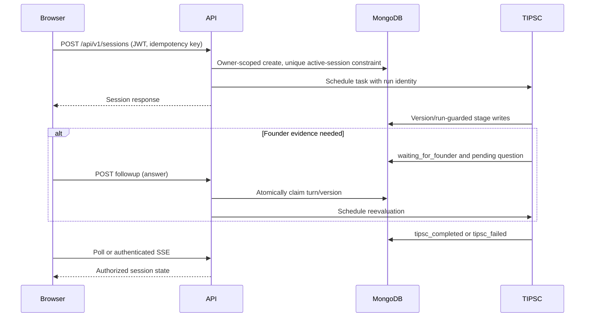
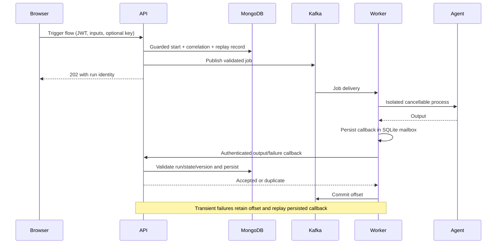

# Execution sequences

## Session and TIPSC

## DFV and Discovery

Interrupted TIPSC work becomes retryable after timeout; it is not resumed midway through a provider call. See [architecture](backend-arch.md) for concurrency and deployment boundaries.
